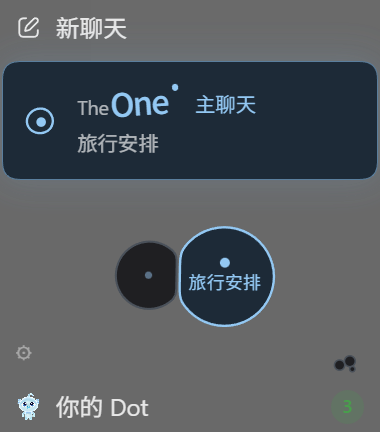

<h1 align="center">TheOne for Codex</h1>

<p align="center"><b>Too many Codex sessions to find anything? Talk in one main chat and let it pick up the right thread.</b><br>Every message is routed to the matter it belongs to; each matter keeps its own Codex session and context, so you can come back days later and carry on.</p>

<p align="center">
  
  
  
</p>

<p align="center"><a href="./README.md">简体中文</a> | English</p>

<p align="center"></p>

---

TheOne started as a plugin for [DeepSeek Harness (DSH)](https://github.com/YunongDai2005/dsh-theone). This is its Codex edition: topics, routing, fact records and the cell interface are ported from DSH TheOne 0.4.6, and model calls use your existing Codex sign-in.

## The problem

- "Where was that conversation again?" Dozens of sessions in the Codex sidebar, and the old one is gone.
- "I'll just ask here." One session collects everything, and details vanish at the next compaction.
- "I told you this already." A new session does not know what an old one settled.

**What TheOne does:** you talk in one main chat. TheOne decides which matter each message belongs to (conversation routing) and sends it to that matter's own Codex session; something new gets a new topic. Answers come back to the main chat, so you only ever see one conversation.

## How routing works

Each message takes the first of these that applies:

1. **You named a topic**: it goes there.
2. **Pre-routing**: routing starts in the background the moment you press send, while the main model is still thinking. By the time the main model hands the task over, the result is usually ready.
3. **The main model's judgement**: the main chat's model has read the whole conversation and knows what "continue" or "that one" refers to. When it is confident and the topic checks out, TheOne uses its choice without another model call.
4. **The routing model**: one model call on your Codex sign-in, with a second look when the first answer is shaky. The prompt, validation and recheck rules are the same as in DSH.
5. **Local rules**: the fallback if a model call fails.

The routing model defaults to GPT-6 Luna at low reasoning effort and can be changed in settings. Measurements: [routing latency record](evidence/router-latency-luna-low.json).

## Features

- **One Codex session per matter**: contexts stay apart; topics in the same project queue so they never edit the same files at once.
- **Topic cells**: under New chat sits the main-chat card, and under it a cell for each topic. Cells that are working, waiting for you or freshly answered show their names; the rest show them when the pointer comes near. Drop one cell on another to merge; drop a message on another cell to reroute it.
- **Fix a wrong route**: rerouting changes where a message belongs and never silently undoes work already done. Likely duplicates are joined by a dotted line for you to decide.
- **One-off asides**: a quick "how many cm in an inch" is answered and folds away, and the main chat returns to the topic you were on.
- **Facts with sources**: settled numbers and decisions are kept with their source and version; when a cited fact changes, the topics using it are told.
- **Organise past chats**: with your consent, a model of your choice reads the sessions you pick and turns them into topic cells. Read-only; your sessions stay as they are.
- **Privacy**: a topic can be private (never shared with other topics) or excluded (kept out of routing and search).
- **Your existing Codex sign-in**: no API key to enter. It uses your Codex account's model quota.

## Install

Requires Codex (desktop or CLI) and Node.js 24 or later.

**Plugin only (desktop and CLI):**

```bash
codex plugin marketplace add YunongDai2005/theone-codex --ref marketplace
```

```bash
codex plugin add theone@theone-codex
```

Restart Codex. On desktop, TheOne appears under Explore / More; pin it to the sidebar. In project chats you can also use `$theone`.

**Full interface (Windows desktop):** the main-chat card and topic cells under New chat need the client adapter. It patches a local copy of Codex desktop and leaves your original install and shortcuts untouched:

```bash
git clone https://github.com/YunongDai2005/theone-codex.git
```

```bash
cd theone-codex && npm ci --ignore-scripts && npm run build && npm run client:install
```

Then start from the **Codex TheOne** desktop shortcut. The adapter targets Codex desktop `26.1103.4239.0`; after Codex updates, run `npm run client:install` again. See [client adapter](docs/client-adapter.md).

## Compared with the DSH edition

| | DSH | Codex |
|---|---|---|
| Model | The provider configured in DSH | Your Codex sign-in |
| When routing runs | Before the answer starts | Alongside the main model's thinking |
| Main model helps route | No | Yes, used when confident |
| Message bridges (WeChat, Telegram, iMessage) | Yes | No (needs the DSH server) |
| Tool-card mirroring | Yes | No (DSH host only) |

Full capability table: [implementation record](docs/implementation-status.md).

## FAQ

**Does it cost extra quota?** Not when the main model is confident. When the routing model is needed, a message costs one extra low-effort call; organising past chats is billed on the model you choose.

**Is the client adapter safe?** It only changes the local copy of Codex desktop it makes, never your original install or your chat data. You can use the plugin alone.

**Is this an official OpenAI project?** No. TheOne is an independent open-source project, not affiliated with OpenAI.

## Verification

`npm run check` runs the type check, all unit tests and the build; the client adapter has `npm run client:test`. Each release lists its test results under [Releases](https://github.com/YunongDai2005/theone-codex/releases).

## Origin and licence

MIT. The core is ported from [YunongDai2005/dsh-theone](https://github.com/YunongDai2005/dsh-theone); sources and commits are listed in [UPSTREAM.md](UPSTREAM.md).
