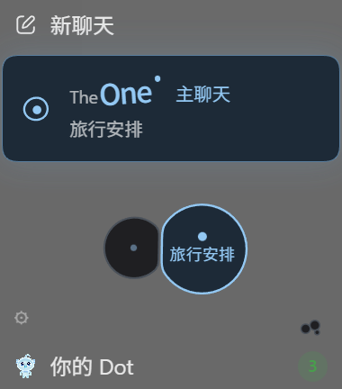

<h1 align="center">TheOne for Codex</h1>

<p align="center"><b>Codex 会话多到翻不到？以后只在一个主聊天里说，它自己接上。</b><br>每句话自动路由到对应的那件事，每件事有自己的 Codex 会话和上下文，隔几天回来也能接着做。</p>

<p align="center">
  
  
  
</p>

<p align="center">简体中文 | <a href="./README.en.md">English</a></p>

<p align="center"></p>

<p align="center"><b>QQ 交流群：1080980184</b>：装不上、分错了、想要什么功能，进群说一声。</p>

---

TheOne 原本是 [DeepSeek Harness（DSH）](https://github.com/YunongDai2005/dsh-theone) 的插件。这是它的 Codex 版本：话题、路由、事实记录和细胞界面都从 DSH TheOne 0.4.6 移植过来，模型调用改用你现有的 Codex 登录。

## 它解决什么

- 「之前聊过的那个在哪来着？」：Codex 侧边栏里几十个会话，旧的找不到。
- 「懒得新建了，就在这儿接着问吧」：一个会话越聊越杂，压缩一次细节就没了。
- 「我不是跟你说过了吗？」：换了会话，AI 不记得之前定下的东西。

**TheOne 的做法：** 你只在一个主聊天里说话。TheOne 判断每条消息属于哪件事（对话路由），把它送进那件事自己的 Codex 会话；新的事就新开一个话题。结果回到主聊天，你看到的始终是一个对话。

## 它怎么做：对话路由

每条消息按这个顺序决定去哪个话题：

1. **你点名了话题**：照你说的。
2. **预路由**：你一按发送，TheOne 就在后台开始路由，和主模型的思考同时进行。等主模型把任务交过来时，结果通常已经出来了。
3. **主模型的判断**：主聊天的模型看过整段对话，「继续」「那个」这类指代它最清楚。它有把握、话题也对得上时，直接采用，不额外调用模型。
4. **路由模型**：用你的 Codex 登录调一次模型判断，判断不稳时再复核一次。路由提示词、校验和复核规则与 DSH 版相同。
5. **本地规则**：模型调用失败时兜底。

路由模型默认用 GPT-6 Luna、低思考强度，可以在设置里换。实测见 [路由延迟记录](evidence/router-latency-luna-low.json)。

## 功能

- **每件事一个独立的 Codex 会话**：上下文互不干扰；同一个项目的话题按顺序排队，不会同时改同一批文件。
- **话题细胞**：「新聊天」下面是主聊天卡片，卡片下的细胞就是你的话题。正在干活、等你回答、刚回答完的细胞会显示名字；其余的鼠标靠近才显示。拖一个细胞到另一个上就是合并，把消息拖到别的细胞上就是改派。
- **分错了能改**：改派只修正归属，不会悄悄撤销已经做过的改动。疑似重复的话题会用虚线连起来，由你决定要不要合并。
- **一次性插问**：「1 英寸是多少厘米」这类顺口一问，回答完自动收起，主聊天回到原来的话题。
- **有出处的事实记录**：定下来的数值和决定会记下来源和版本；被引用的事实变了，相关话题会收到通知。
- **整理以前的聊天**：经你同意后，用你选的模型读一遍选中的旧会话，整理成话题细胞。只读不改，原会话原样保留。
- **隐私**：话题可以设为私密（不共享给其他话题）或排除（不参与路由和检索）。
- **用你现有的 Codex 登录**：不用另填 API Key。会消耗你 Codex 账户的模型额度。

## 安装

需要 Codex（桌面版或 CLI）和 Node.js 24 以上。

**只装插件（桌面版和 CLI 都能用）：**

```bash
codex plugin marketplace add YunongDai2005/theone-codex --ref marketplace
```

```bash
codex plugin add theone@theone-codex
```

装好后重启 Codex。桌面版的 TheOne 入口在「探索 / 更多」里，固定后进入侧边栏；项目聊天里也可以用 `$theone`。

**完整界面（Windows 桌面版）：** 想要「新聊天」下面的主聊天卡片和话题细胞，还需要装客户端适配。它会在本机复制一份 Codex 桌面版再打补丁，原版安装和快捷方式保留不动：

```bash
git clone https://github.com/YunongDai2005/theone-codex.git
```

```bash
cd theone-codex && npm ci --ignore-scripts && npm run build && npm run client:install
```

之后从桌面的 **Codex TheOne** 快捷方式启动。客户端适配针对 Codex 桌面版 `26.1103.4239.0`，原版升级后需要重新运行 `npm run client:install`。详见 [客户端适配](docs/client-adapter.md)。

## 和 DSH 版的区别

| | DSH 版 | Codex 版 |
|---|---|---|
| 模型 | DSH 里配置的服务商 | 你的 Codex 登录 |
| 路由的时机 | 路由完才开始回答 | 和主模型思考同时进行 |
| 主模型参与路由 | 否 | 是，有把握时直接采用 |
| 消息桥（微信、Telegram、iMessage） | 有 | 没有（依赖 DSH 服务端） |
| 工具卡片镜像 | 有 | 没有（DSH 宿主特有） |

完整的能力表见 [实现记录](docs/implementation-status.md)。

## 常见问题

**会多花额度吗？** 主模型有把握时不额外调用。需要路由模型时，每条消息多一次低思考强度的调用；整理旧聊天按你选的模型计费。

**客户端适配安全吗？** 它只改本机复制出来的那一份 Codex 桌面版，不改原版安装，也不改你的聊天数据。不想用可以只装插件。

**这是 OpenAI 官方的吗？** 不是。TheOne 是独立的开源项目，与 OpenAI 无关。

## 验证

`npm run check`：类型检查、全部单元测试和构建。客户端适配另有 `npm run client:test`。每次发版的测试结果写在 [Releases](https://github.com/YunongDai2005/theone-codex/releases) 里。

## 来源和许可

MIT。核心代码移植自 [YunongDai2005/dsh-theone](https://github.com/YunongDai2005/dsh-theone)，来源和对应提交见 [UPSTREAM.md](UPSTREAM.md)。
