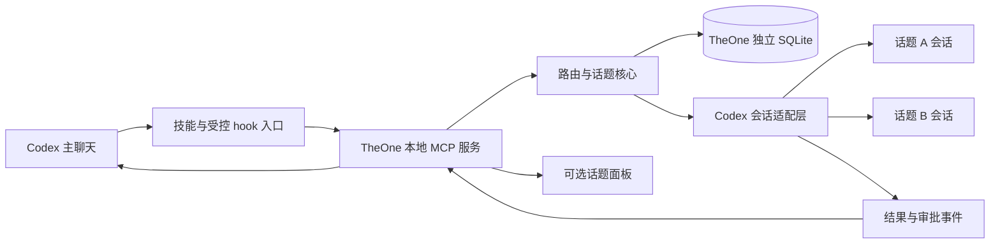

# TheOne 移植到 Codex 的方案

本文件保留准备阶段方案及目标范围。已实现项、验证结果和仍缺功能见 [实现记录](implementation-status.md)。

2026-11-09。首选目标为本机 Windows 上的原生 Codex 桌面插件，CLI 用于协议检查与适配层开发。先保住一个入口、多话题独立上下文、准确续接这三个核心行为。

## 宿主能力对照

下表的「协议存在」来自本机 CLI 导出的 schema，不表示插件已获得连接权限，也不表示原生界面已经验证。

| TheOne 需求 | Codex 依据 | 移植判断 |
| --- | --- | --- |
| 插件打包、技能入口 | 官方插件包支持 Skills 与 MCP；本机有对应插件协议 | 可作为分发与用户启用入口 |
| 每次用户输入前参与 | `UserPromptSubmit` 可提供上下文或阻止输入 | 可做路由提示与绑定；不能由此推导出能够替换完整响应流 |
| 创建、恢复独立话题 | `thread/start`、`thread/resume` | 基础协议存在；要验证与桌面端会话的归属及连接方式 |
| 启动、追加、取消工作 | `turn/start`、`turn/steer`、`turn/interrupt` | 协议存在；steer 必须绑定当前 turn，竞态时不能重复发起 |
| 接收后台流 | `item/agentMessage/delta`、item/turn 通知 | 可供自有适配层消费；如何映射到原生主聊天需实测 |
| 回填历史资料 | `thread/inject_items` | 文档与 schema 都有；它追加模型可见历史，不能等同于替换原生 UI、回放工具卡片或启动新回合 |
| 审批与提问 | `item/commandExecution/requestApproval`、`item/fileChange/requestApproval`、`item/tool/requestUserInput` 等 server request | 必须在适配层绑定来源并回复；原生插件如何展示需验证 |
| 历史阅读与搜索 | 普通协议有 thread 列表和 turn/item 分页；实验协议有 `thread/search`、`thread/searchOccurrences` | 先读取明确授权范围并建立自己的搜索索引；实验搜索作为可选优化 |
| 话题目录与设置 | 官方 Plugin Extensions 描述侧栏应用、会话面板与插件设置 | 优先测试这些扩展；当前 Windows Codex 可用范围待确认 |
| 话题简报、压缩 | 本地状态存储、`thread/compact/start`、会话 hook | 策略可迁移，压缩前后引用的保留情况必须重测 |
| 后台完成后主动回到主聊天 | App Server 事件、MCP 结果或 UI 通知可能参与 | 本地主聊天的可靠唤醒链尚未建立；不能直接套用云端 MCP Events |
| DSH 式模型输出与工具镜像接管 | 已查官方接口未建立等价实现路径 | 属于首要技术验证项，不能宣布已支持或永远不支持 |

官方依据：[插件打包](https://developers.openai.com/plugins/build/plugins)、[Hooks](https://learn.chatgpt.com/docs/hooks)、[App Server](https://learn.chatgpt.com/docs/app-server)、[MCP](https://learn.chatgpt.com/docs/extend/mcp)、[Plugin Extensions](https://developers.openai.com/plugins/build/extensions)、[MCP UI](https://developers.openai.com/plugins/build/chatgpt-ui)。MCP Events 文档目前列出的运行范围包含云端 Work 与 dots，不能据此承诺本地 Codex 的主动唤醒。[MCP Events](https://developers.openai.com/plugins/build/mcp-events)

## 推荐结构

这是待验证的设计。主聊天与服务之间如何持续传回结果、审批和后台完成信号，属于 P0，不能用图中的连线替代实际验证。

核心只负责话题、候选召回、分配、绑定、简报、状态和持久化；Codex 适配层负责会话与执行。技能描述用户如何启用和使用，MCP 暴露受控操作，hook 只为启用 TheOne 的主聊天提供最小入口。普通聊天与 worker 不应再次进入主入口路由。

建议由一个本地服务持有数据库和工作队列。不要让每次 MCP 调用都启动一套独立服务，也不要并发恢复同一个活跃话题到多个 App Server 进程。会话操作必须明确针对哪个 host、哪个 server 与哪个 thread。

## P0 宿主接入验证

这一步规模应小于完整路由移植，只使用新建的测试话题、虚构内容与测试项目。

1. **安装与信任。** 验证最小本地插件、MCP 工具、hook 的发现、启用和作用范围。插件安装不等于 hook 已被信任；记录需要用户完成的实际宿主步骤。首轮先用显式技能入口，随后测试已启用主聊天的自动入口。
2. **会话归属。** 确认连接自有 App Server 还是有文档支持的既有服务连接；分别记录会话可见性、重启后恢复、连接释放行为。不得把本次聊天内置的 `mcp__codex_app` 工具当作第三方插件可直接调用的 API。
3. **最小闭环。** A/B 两个话题依次收到不同消息，再续接 A；分别观察 input、thread、turn、item 和结果展示，证明上下文没有混用。
4. **审批、追问与取消。** 先使用模拟事件验证请求绑定，再在测试目录中验证一项真实待批准操作和一次取消。连接丢失、过期或无回应时不得批准或重放操作。
5. **主聊天输出。** 记录 MCP 返回、原生回复、`thread/inject_items` 与可选面板分别能提供什么。必须检查重复回复、工具重复执行、后台结束后的唤醒、主聊天历史增长。
6. **模型调用。** 评估路由调用的可用入口、实际延迟和额度记账。不能把账号登录态当作 OpenAI API Key，也不能承诺沿用 DSH 的成本数据。

P0 通过条件：明确一种真实可用的原生入口，完成输入→独立会话→结果返回，且审批与取消不会丢失。若只能做到模型按技能调用 MCP 并转述结果，应明确其额外模型开销与行为差异，再决定是否符合产品目标。

若原生回复镜像仍不可达，可继续试验插件自己的 MCP App 主聊天面板。单独开发 App Server 客户端属于后续备选产品形态，不应默默替代用户要求的 Codex 插件。

## P1 提取核心与建立适配层

- 以固定提交抽取领域类型、规则路由、决策校验、状态和存储；在这个项目中开始，保留来源与 License。
- 将 `DshRouter` 的传输与领域逻辑分离，模型、历史、执行和展示按 [适配层约定](adapter-contracts.md) 接入。
- 建立独立的数据命名空间与新数据库；仅在显式导入时读取原 DSH 的导出副本，不把 DSH 的会话 ID 直接改写成 Codex ID。
- 迁移原行为用例，增加 Codex 事件夹具；实现顺序为规则路由、模型路由、话题简报、运行恢复。

## P2 最小可用插件

首版覆盖文本消息、多话题创建/续接、状态目录、显式纠错、基础查阅、取消与重启恢复；执行仍由 Codex 完成。只处理用户已启用的 TheOne 主入口。

首版以串行执行作为起点，验证稳定后加入跨项目并发。同项目需要统一队列；话题分开不代表文件、分支、终端与外部操作已隔离。

话题目录先保持无 UI 也可使用，再接入当前宿主实际支持的侧栏应用或会话面板。微信、Telegram、iMessage、持续任务、反馈服务和跨平台发布放在核心验收之后。

## P3 真实使用与发布准备

按 [验收清单](acceptance.md) 跑完整桌面链，再用经授权的真实场景评估路由误伤、重复执行、上下文混入、延迟与费用。原项目的评测数字不能当作 Codex 版指标。

官方便携包入口是根目录 `plugin.json`、`mcp.json`、`skills/`，OpenAI 特有设置放入 `extensions.com.openai`；兼容格式 `.codex-plugin/plugin.json` 仍有支持。以本机安装实测决定最终包格式。含生命周期 hooks 的插件当前不符合公开插件目录提交条件，需按手动安装的桌面方案规划分发。[插件打包与分发](https://developers.openai.com/plugins/build/plugins)

## 需要保留为可选项的实验接口

本机实验 schema 包含 `thread/sample`：需要 `threadId`、`expectedTurnId`、`prompt`，源回合必须已结束，返回文本也可能为空。它不适合直接假定为「每条输入都能调用的独立无上下文分类器」，暂不放入核心依赖。

本机普通 schema 未包含 `ThreadStartParams.permissions`、`dynamicTools`、`historyMode` 等字段，这些在实验导出中才出现。`turn/start.additionalContext` 同样如此。普通协议导出也不等于稳定性承诺；版本更新后重新导出并比较。[本机协议证据](../evidence/codex-0.167.0-alpha.3.2/capabilities.json)
